# VibeFusion AI

Mobile audio platform for **free, openly licensed** music, podcasts and motivational speeches, with an
**AI Fusion Studio** that turns a prompt into an editable, rights-validated multi-layer mix plan rendered
deterministically on device.

| Part | Stack | Path |
|---|---|---|
| Shared API (modular monolith) | TypeScript, Fastify 5, PostgreSQL (embedded PGlite for dev), Ajv | [`backend/`](backend) |
| iOS app | SwiftUI, Observation, AVPlayer, AVAudioEngine, SwiftData, Keychain | [`ios/`](ios) |
| Android app | Kotlin, Jetpack Compose, Hilt, Media3 (ExoPlayer + MediaLibraryService), AudioTrack/MediaCodec mixer, Room, Keystore | [`android/`](android) |
| Contracts | OpenAPI 3.1, JSON Schema (mix plan), cross-platform fixtures | [`contracts/`](contracts) |
| Docs & ADRs | Architecture, API, data model, audio engine, rights policy, test plan | [`docs/`](docs) |

## Screenshots

Captured from the running apps against the local backend with real open-licence content
(iOS via `ScreenshotTests`, Android on the API 36 emulator).

### iOS

| Home | Discover | Podcasts | Motivation |
|---|---|---|---|
| 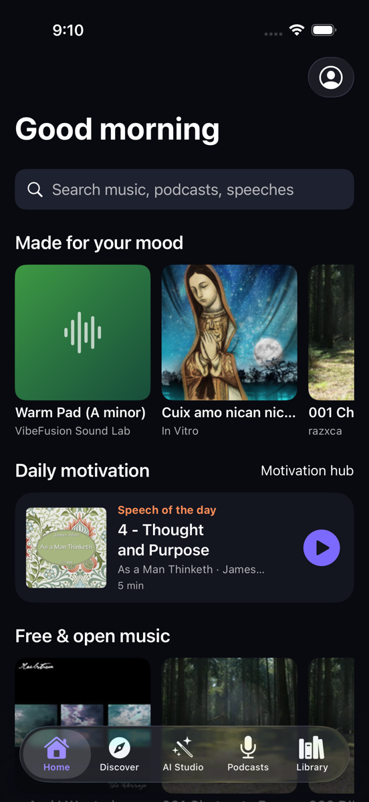 | 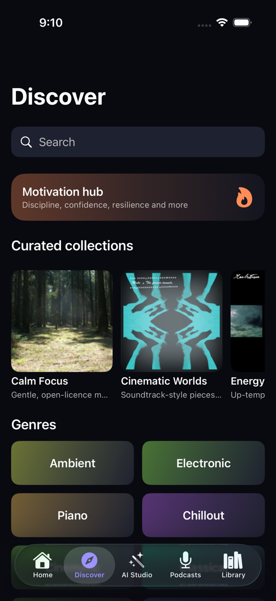 | 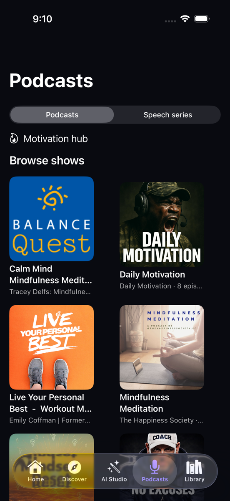 | 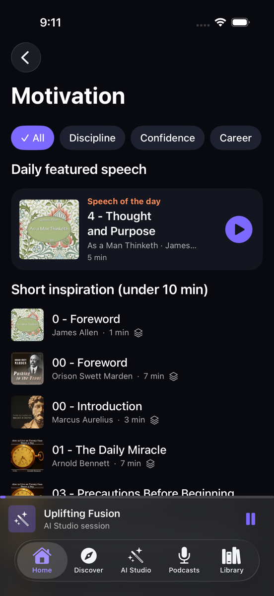 |

| Player | AI Studio | Mix editor | Fusion preview |
|---|---|---|---|
| 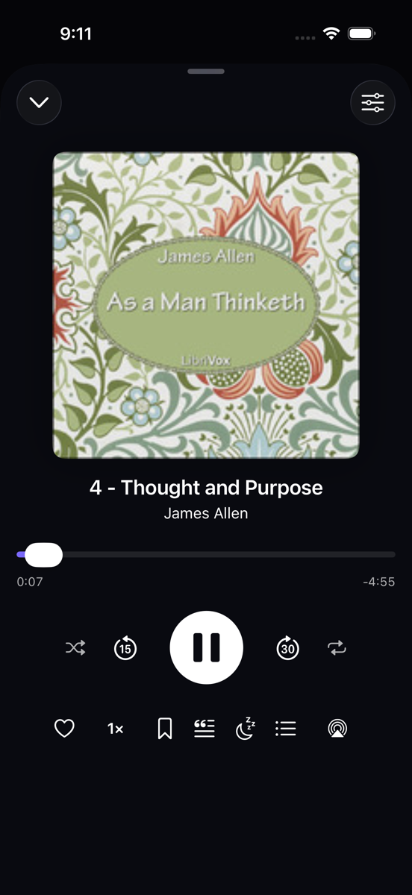 | 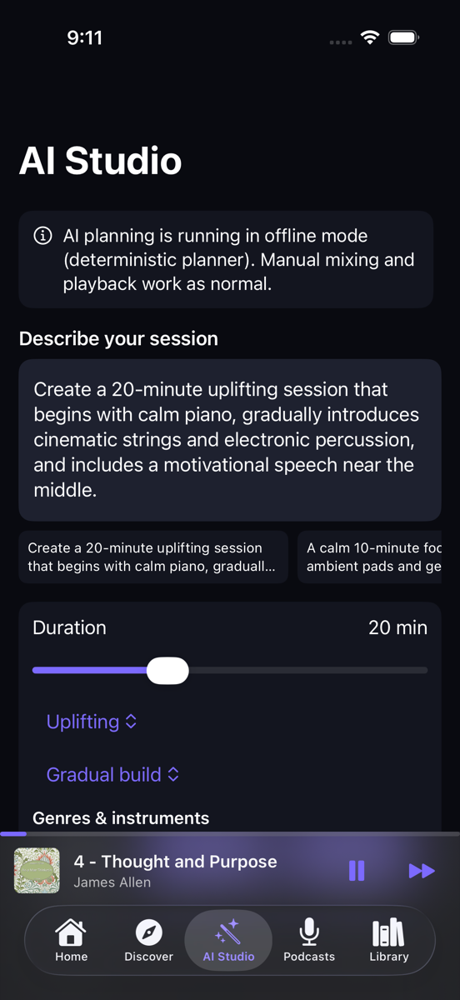 | 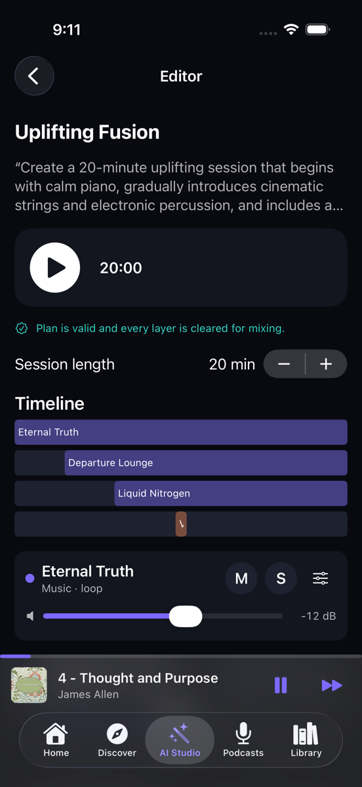 | 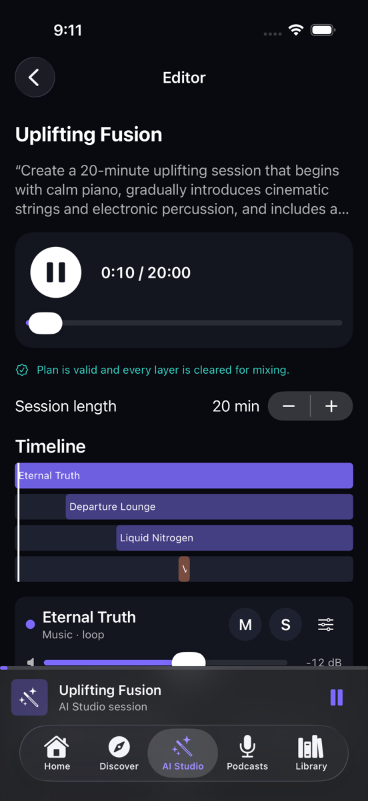 |

| Welcome | Interests |
|---|---|
| 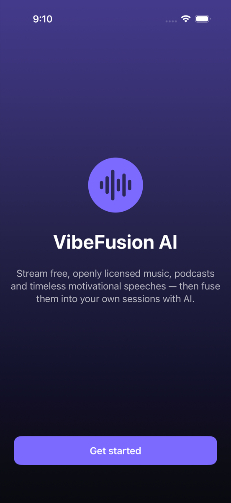 | 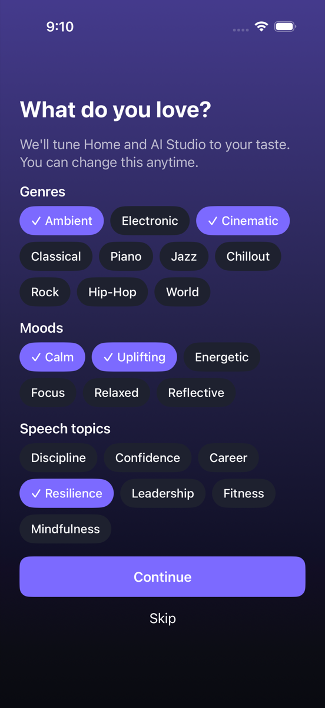 |

### Android

| Welcome | AI Studio | Mix editor | Fusion preview |
|---|---|---|---|
| 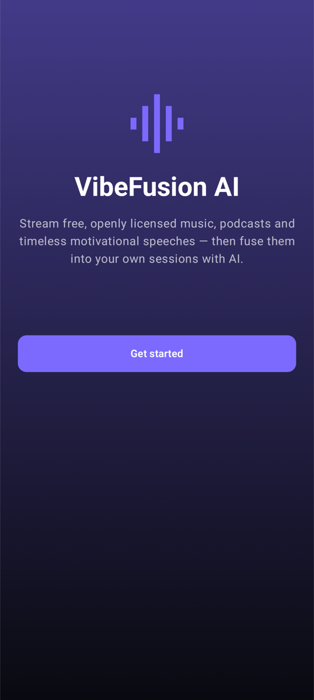 | 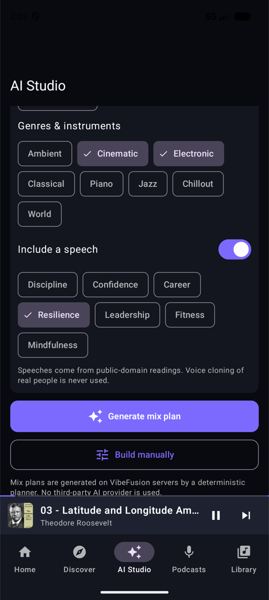 | 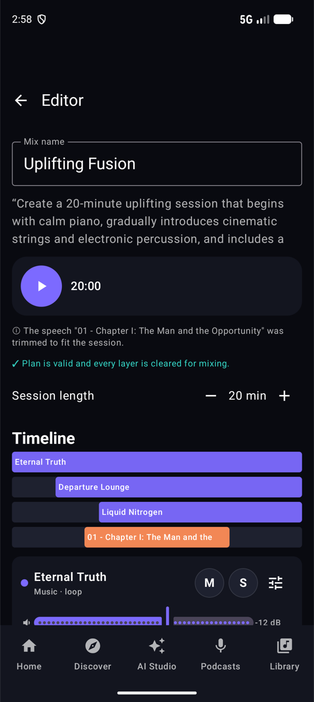 | 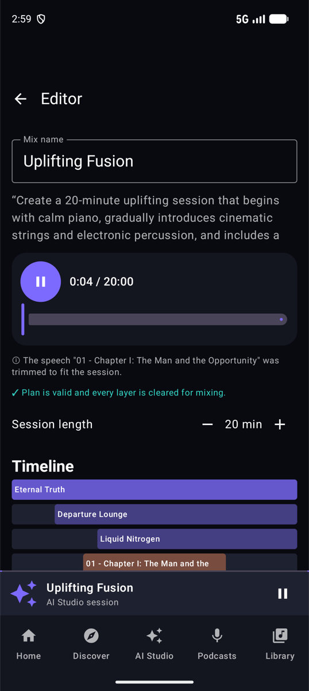 |

Regenerate the iOS set with a backend running:
`TEST_RUNNER_VF_SCREENSHOTS=1 TEST_RUNNER_VF_TEST_SERVER=http://localhost:8080 xcodebuild test -project ios/VibeFusion.xcodeproj -scheme VibeFusion -destination 'platform=iOS Simulator,name=iPhone 17 Pro' -only-testing:VibeFusionUITests/ScreenshotTests`

## Content: free sources only

No commercial catalogue and no unlicensed streams. Every asset is ingested together with a **rights grant**
derived from the licence its source publishes; anything unknown or NonCommercial is skipped.

| Source | What | Licence → allowed uses |
|---|---|---|
| Internet Archive netlabels | Music | CC BY / BY-SA / CC0 / PD → stream, download, mix, export (attribution shown). CC BY-ND → stream + download only |
| LibriVox (via Internet Archive) | Motivational speeches (James Allen, Emerson, Marcus Aurelius, Conwell, Roosevelt…) | Public domain → all uses |
| Podcast RSS (discovered via iTunes Search API) | Podcasts | Publisher feed → stream + personal download; **never mixed** |
| VibeFusion Sound Lab | Synthetic loops/stems generated by the server | Owned → all uses (dev + always-available Fusion material) |

## Quick start

```bash
# 1. Backend (Node 20+). Uses embedded Postgres (PGlite) — no Docker needed.
cd backend && npm install && npm run dev        # http://localhost:8080, ingests free content on first start
npm test && npm run contracts:validate            # 55 tests + OpenAPI/schema/route checks

# Optional: real PostgreSQL
docker compose -f infrastructure/docker/docker-compose.yml up -d

# Optional: LLM planner (otherwise a deterministic rule-based planner is used)
export ANTHROPIC_API_KEY=...                      # never shipped in the mobile apps

# 2. iOS (Xcode 16+, XcodeGen)
cd ios && xcodegen generate && open VibeFusion.xcodeproj
# Simulator talks to http://localhost:8080 (Profile → Developer lets you change it in Debug builds)

# 3. Android (JDK 17+, Android SDK 35)
cd android && ./gradlew :app:installDebug          # emulator reaches the host at http://10.0.2.2:8080
# Different server: ./gradlew :app:installDebug -PvfApiBaseUrl=http://10.0.2.2:8099
```

## Status

See [`PROGRESS.md`](PROGRESS.md) for the phase checklist, what was verified, and known limitations.
